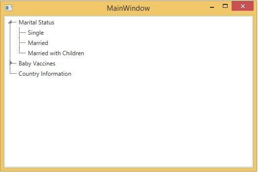

# How to Programmatically Expand an Item in WPF TreeViewAdv?

This sample shows how to programmatically expand an item in [WPF TreeView](https://help.syncfusion.com/wpf/classic/treeview/overview) (TreeViewAdv).

`TreeViewAdv` allows to expand or collapse each node by setting [IsExpanded](https://help.syncfusion.com/cr/wpf/Syncfusion.Windows.Tools.Controls.TreeViewItemAdv.html#Syncfusion_Windows_Tools_Controls_TreeViewItemAdv_IsExpanded) property.

#### XAML

``` csharp
<Grid x:Name="Grid">
    <syncfusion:TreeViewAdv Name="treeViewAdv">
        <syncfusion:TreeViewItemAdv Name="treeViewItemAdv" Header="Marital Status">
            <syncfusion:TreeViewItemAdv Header="Single"/>
            <syncfusion:TreeViewItemAdv Header="Married"/>
            <syncfusion:TreeViewItemAdv Header="Married with Children"/>
        </syncfusion:TreeViewItemAdv>
        <syncfusion:TreeViewItemAdv Header="Baby Vaccines">
            <syncfusion:TreeViewItemAdv Header="Hepatitis B"/>
            <syncfusion:TreeViewItemAdv Header="Tetanus"/>
            <syncfusion:TreeViewItemAdv Header="Polio"/>
            <syncfusion:TreeViewItemAdv Header="Measles"/>
        </syncfusion:TreeViewItemAdv>
        <syncfusion:TreeViewItemAdv Header="Country Information"/>
    </syncfusion:TreeViewAdv>
</Grid>
```

#### C#

``` csharp
public MainWindow()
{
    InitializeComponent();
    TreeViewAdv treeViewAdv = new TreeViewAdv();
    TreeViewItemAdv root1 = new TreeViewItemAdv() { Header = "Marital Status" };
    TreeViewItemAdv subitem11 = new TreeViewItemAdv() { Header = "Single" };
    TreeViewItemAdv subitem12 = new TreeViewItemAdv() { Header = "Married" };
    TreeViewItemAdv subitem13 = new TreeViewItemAdv() { Header = "Married with Children" };

    root1.Items.Add(subitem11);
    root1.Items.Add(subitem12);
    root1.Items.Add(subitem13);

    TreeViewItemAdv root2 = new TreeViewItemAdv() { Header = "Baby Vaccines" };
    TreeViewItemAdv subitem21 = new TreeViewItemAdv() { Header = "Hepatitis B" };
    TreeViewItemAdv subitem22 = new TreeViewItemAdv() { Header = "Tetanus" };
    TreeViewItemAdv subitem23 = new TreeViewItemAdv() { Header = "Polio" };
    TreeViewItemAdv subitem24 = new TreeViewItemAdv() { Header = "Measles" };

    root2.Items.Add(subitem21);
    root2.Items.Add(subitem22);
    root2.Items.Add(subitem23);
    root2.Items.Add(subitem24);

    TreeViewItemAdv root3 = new TreeViewItemAdv() { Header = "Baby Vaccines" };
    treeViewAdv.Items.Add(root1);
    treeViewAdv.Items.Add(root2);
    treeViewAdv.Items.Add(root3);
    Grid.Children.Add(treeViewAdv);
    root1.IsExpanded = true;
}
```

#### VB

``` vb
Public Sub New()
    InitializeComponent()
    Dim treeViewAdv As TreeViewAdv = New TreeViewAdv()
    Dim root1 As TreeViewItemAdv = New TreeViewItemAdv() With {.Header = "Marital Status"}
    Dim subitem11 As TreeViewItemAdv = New TreeViewItemAdv() With {.Header = "Single"}
    Dim subitem12 As TreeViewItemAdv = New TreeViewItemAdv() With {.Header = "Married"}
    Dim subitem13 As TreeViewItemAdv = New TreeViewItemAdv() With {.Header = "Married with Children"}

    root1.Items.Add(subitem11)
    root1.Items.Add(subitem12)
    root1.Items.Add(subitem13)

    Dim root2 As TreeViewItemAdv = New TreeViewItemAdv() With {.Header = "Baby Vaccines"}
    Dim subitem21 As TreeViewItemAdv = New TreeViewItemAdv() With {.Header = "Hepatitis B"}
    Dim subitem22 As TreeViewItemAdv = New TreeViewItemAdv() With {.Header = "Tetanus"}
    Dim subitem23 As TreeViewItemAdv = New TreeViewItemAdv() With {.Header = "Polio"}
    Dim subitem24 As TreeViewItemAdv = New TreeViewItemAdv() With {.Header = "Measles"}

    root2.Items.Add(subitem21)
    root2.Items.Add(subitem22)
    root2.Items.Add(subitem23)
    root2.Items.Add(subitem24)

    Dim root3 As TreeViewItemAdv = New TreeViewItemAdv() With {.Header = "Baby Vaccines"}
    treeViewAdv.Items.Add(root1)
    treeViewAdv.Items.Add(root2)
    treeViewAdv.Items.Add(root3)
    Grid.Children.Add(treeViewAdv)
    root1.IsExpanded = True
End Sub
```


